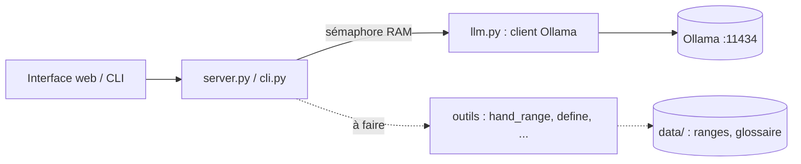

# Feuille de route SensAI

État au 2026-09-21. Les durées sont des **estimations**. Date de rendu et de keynote : **à renseigner**.

## 1. Où on en est

| Fait | Détail |
|---|---|
| Client Ollama | `llm.py` : streaming, erreurs claires (modèle absent, connexion coupée), historique géré par l'appelant |
| Interface web (X1) | `server.py` + `web/index.html` : chat en streaming, bouton Stop, réflexion du modèle séparée, débit en tokens/s |
| Comparaison multi-modèles | Une colonne par modèle ; un **sémaphore** (`max_parallel_models`, 1 par défaut) met les autres en pause et décharge chaque modèle après usage. Vérifié avec les vrais modèles. |
| Modèles installés | `qwen3:4b-instruct-2507-q4_K_M`, `llama3.2:3b`, `gemma3:4b`, `qwen3:4b` (2 à 3,3 Go chacun) |
| Données poker | `preflop_rfi.json` + `hand_range()` ; glossaire de 327 entrées + `define()` |
| Tests | 26 tests (`test_web.py` avec un faux Ollama, `test_preflop.py`, `test_glossary.py`) |
| Documentation des données | `data/SOURCE.md`, `data/DONNEES_A_AJOUTER.md` (18 pistes) |

| Pas fait | Pourquoi ça compte |
|---|---|
| **CLI (B1)** | Obligatoire. `main.py` n'est qu'un squelette qui utilise le paquet `ollama`, alors que le sujet demande l'API HTTP « directement ». |
| Cadrage écrit | Livrable du bootstrap : cas d'usage, features justifiées avec dépendances, architecture. |
| User stories | Livrable : au moins 2 par feature. |
| Tool calling | **Jamais testé** sur nos modèles. C'est le plus gros risque du projet (T1). |
| Jeu d'évaluation | Sans lui, impossible de savoir si un changement améliore quoi que ce soit. |
| README complet | Livrable (installation, features, exemples d'utilisation). |

## 2. Cadre proposé (à valider en groupe)

**Cas d'usage.** *Qui :* un joueur de Texas Hold'em débutant ou intermédiaire, qui s'entraîne seul.
*Quoi :* jouer des mains contre une IA, puis comprendre ses erreurs.
*Pourquoi pas sans :* un coach humain coûte cher, un solveur est illisible, et un LLM seul se trompe. Preuve
mesurée : sur « Quelle est la meilleure main au poker », 3 des 4 modèles testés se sont trompés (le 4e a
répondu juste, après 2 208 tokens de réflexion).

**Features retenues (6, plus une déjà faite).** B1, T1 (MCP), T5 (sortie JSON), A5 (personas), M3 (SQLite),
X4 (questions/formulaires). X1 (interface web) est déjà en place.
Le catalogue note qu'il vaut mieux peu de features bien intégrées.

## 3. Aujourd'hui, dans cet ordre

Chaque bloc se termine par un commit et un push.

### Bloc 0 : équipe et dépôt (15 min)
- Ajouter les coéquipiers en collaborateurs (il faut leurs identifiants GitHub).
- Convention : commits `type: description`, une branche par bloc, revue avant fusion.
- Décider si le dépôt garde le nom `SensAI-Copie`.

### Bloc 1 : verrouiller le cadrage (1 h)
- Chacun répond seul aux 4 questions du bootstrap, puis on compare.
- Écrire `docs/cadrage.md` : cas d'usage, liste de features justifiée, dépendances, schéma ci-dessus.
- Appliquer les 4 tests du bootstrap : démo, temps, profondeur, coupure. Quelle feature enlève-t-on en dernier ?
- **Terminé quand** chaque membre sait expliquer chaque composant.

### Bloc 2 : le socle obligatoire, la CLI (1 à 1,5 h)
- `cli.py` réutilise `llm.stream_chat` : modèle en argument ou dans `config.json`, prompt système lu depuis un
  fichier, streaming, historique de session, erreurs (modèle absent, entrée vide, connexion coupée).
- Remplacer le contenu de `main.py` : plus de paquet `ollama`.
- **Terminé quand** les 5 critères de la section « Ollama chatbot MVP » du bootstrap sont cochés.

### Bloc 3 : lever le risque n°1, le tool calling (1,5 à 2 h)
- Tester le paramètre `tools` d'Ollama sur `qwen3:4b-instruct-2507`, `llama3.2:3b` et `gemma3:4b` (10 questions).
  Mesurer : le modèle appelle-t-il `hand_range` ou `define` quand il le faut, avec les bons arguments ?
- Créer `tools.py` : schémas et registre d'outils, à partir de `hand_range` et `define`.
- Vérifier ce que le sujet attend exactement d'un « MCP » (voir les questions plus bas).
- **Terminé quand** on a un taux de réussite par modèle et un choix de modèle par défaut.
- **Plan B si ça échoue :** sortie JSON contrainte (T5), et c'est notre code qui appelle l'outil.

### Bloc 4 : les données de priorité 1 (1 à 1,5 h)
- D1 : `hand_rankings.json` (10 combinaisons, français/anglais) et une fonction `compare_hands`.
- D2 : index inverse français → anglais. D3 : surnoms de mains (`cowboys` → `KK`).
- D4 : jeu d'évaluation de 30 questions à réponse vérifiée, et un script qui note chaque modèle.
- **Terminé quand** le script affiche un score par modèle, dont « meilleure main ».

### Bloc 5 : les livrables rédigés (45 min)
- Compléter le README.
- User stories : 2 pour B1, 2 pour X1, 2 pour T1 (format « En tant que… je veux… afin de… » plus critères).

**Total estimé : 6 à 8 h.** Si le temps manque, garder les blocs 1, 2 et 3 : ils débloquent tout le reste.

## 4. Cette semaine

- T5 : l'action de l'IA en JSON `{action, montant}`. A5 : personas (adversaire prudent, adversaire bluffeur, coach).
- M3 : historique des mains et défauts du joueur dans SQLite. X4 : « suivre, relancer, se coucher ? ».
- Données D5 à D9 : ranges face à une relance (41 charts déjà dans la source), équité, cotes, cadre de raisonnement.
- Décocher `qwen3:4b` par défaut en mode comparaison (il a dépensé 2 208 tokens pour trois mots), ou plafonner la durée.
- Scénario du keynote et démos de repli enregistrées : le sujet insiste sur ce point.

## 5. Questions pour le follow-up

1. Le paquet Python `ollama` est-il autorisé ? Le sujet dit « API HTTP directement ».
2. Que mesurent les étoiles du catalogue ? Un seul barème est affiché, alors que le sujet parle de deux axes.
3. La comparaison multi-modèles avec sémaphore compte-t-elle comme une feature ? Elle n'est pas au catalogue.
4. Le fine-tuning est-il valorisé ? Il n'est pas au catalogue.
5. T1 : que veut dire « testé avec un outil MCP existant » ? Serveur MCP, client MCP, ou les deux ?

## 6. Risques

| Risque | Réponse |
|---|---|
| Tool calling peu fiable sur des modèles de 3 à 4 milliards de paramètres | Mesurer au bloc 3 ; plan B en JSON contraint |
| ~10 tokens/s en CPU : démos lentes | Modèle sans réflexion, sorties courtes, démos de repli |
| 13 Go de RAM | Un seul modèle à la fois ; fermer le navigateur pour tester un 8B |
| Droits des données tierces (glossaire, ranges) | Dépôt privé : OK. Ne pas publier (voir `data/SOURCE.md`) |
| Trop de features | Rester à 6 ; appliquer le test de coupure |
