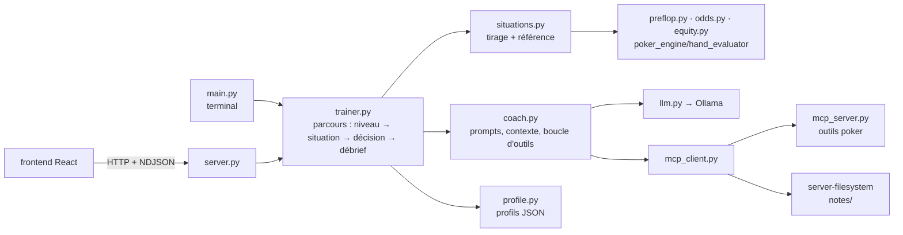

# Plan de refonte : SensAI, entraîneur de poker

Rédigé le 2026-10-06, à partir de la branche `feat/ai-frontend` (frontend commité en `866471b`, CLI B1 et outils
T1 encore non commités). **Statut : proposition à valider en équipe.** Les choix marqués « décision » sont listés
en section 11.

## 1. Le nouveau produit en une phrase

SensAI demande son niveau au joueur, le place dans une situation de poker précise et adaptée à ce niveau, note sa
décision, puis en discute avec lui : quel était le bon coup, pourquoi, et « et si j'avais eu… ? ».

### Cas d'usage (bootstrap, outil 2)

- **Qui ?** Un joueur de Texas Hold'em débutant ou intermédiaire, qui joue entre amis ou en ligne à petites
  mises, seul face à ses erreurs.
- **Que veut-il ?** Savoir s'il a pris la bonne décision dans un coup précis, et comprendre pourquoi, à son niveau.
- **Pourquoi pas sans SensAI ?** Les tableaux de ranges et les calculateurs d'équité donnent un chiffre sans
  explication, les vidéos expliquent sans le faire jouer, et un chatbot généraliste se trompe sur les chiffres
  (mesuré, voir section 2). SensAI fait jouer, corrige avec des chiffres exacts et répond aux questions, en local.

Ce cas d'usage écarte d'emblée le multi-joueur, la recherche web, l'exécution de code et la planification.

### Le parcours (identique en CLI et sur le web)

```
1. Niveau       SensAI demande le niveau (choix ou réponse libre) et le retient dans le profil.
2. Situation    Le code tire une situation adaptée : position, cartes, board, pot, mise à payer.
3. Décision     Le joueur choisit : se coucher, suivre, checker, miser ou relancer (avec montant).
4. Correction   Le code note la décision (bon / acceptable / erreur) d'après une référence calculée.
5. Débrief      Chat en streaming avec le coach, qui connaît la situation, la décision et la référence,
                et peut appeler des outils (équité, ranges, glossaire, carnet de notes).
→ /exercice : nouvelle situation ; le profil garde les résultats pour choisir les suivantes.
```

Exemple de session cible en CLI :

```
$ python3 main.py
SensAI · qwen3:4b-instruct · 7 outils
Bonjour ! Quel est ton niveau au poker ?
  1. Je découvre (je connais à peine les règles)
  2. Je joue un peu (je connais les combinaisons et les positions)
  3. Je joue souvent (je calcule mes cotes)
> 2
Situation 1 · table 6 joueurs, 100 blindes · tu es au bouton (BTN).
Tout le monde s'est couché avant toi. Tu as K♦ 9♦. Que fais-tu ?
  [f] se coucher   [r] relancer
> f
Pas tout à fait : K9 assortis s'ouvre au bouton (référence : ranges 6-max 100bb).
> Pourquoi ? Je n'ai qu'un roi.
[outil] preflop_open({"hand": "K9s"})
Au bouton, seuls les deux blindes parlent après toi… (réponse en streaming)
```

## 2. Principe directeur : le code calcule, le LLM explique

Mesure du 2026-10-05 (`evaluation/resultats.md`, qwen3:4b-instruct) : **18 questions réussies sur 33**. Sur les
15 échecs, **10 portent exactement sur ce qu'on veut enseigner** : le préflop (3 ratées sur 3, dont 2 réponses
contredites), l'équité (3 sur 3) et les outs ou la cote du pot (4 sur 5). Pendant le test de T1, le modèle a aussi
transcrit « dame de cœur » en `Kc` avant qu'on lui donne la correspondance des noms de cartes.

Conséquences sur l'architecture :

1. **La bonne réponse de chaque situation est calculée par le code**, à partir de sources déjà dans le dépôt :
   `preflop.py` (ranges d'ouverture), `odds.py` (outs, cote du pot), `equity.py` (équité),
   `poker_engine/hand_evaluator.py` (qui gagne).
2. **Le LLM reçoit cette référence** dans son contexte et l'explique au niveau du joueur, sans la recalculer.
3. **Les questions « et si… ? » passent par les outils** (T1), qui renvoient des chiffres exacts.
4. **La présentation de la situation est un gabarit**, pas un texte généré : aucun chiffre ne peut être déformé,
   et on économise un appel au modèle (15 à 40 s sur CPU).

## 3. Exigences du sujet : où on en est

| Exigence (sujet, bootstrap) | État sur `feat/ai-frontend` | Action |
|---|---|---|
| CLI connecté à Ollama par son API HTTP | ✅ `main.py` + `llm.py` | Garder, brancher le parcours dessus |
| Réponses en streaming | ✅ | — |
| Historique dans la session | ✅ | Le débrief garde l'historique de la situation |
| Erreurs : modèle absent, entrée vide, connexion | ✅ testées (`test_cli.py`) | — |
| Modèle choisi par argument ou fichier de config | ✅ `--model`, `config.json` | — |
| Prompt système chargé depuis un fichier | ✅ pour `main.py` ; ❌ `ai.py` le code en dur | Un fichier de prompt par rôle (`prompts/`) |
| Pas de framework LLM (LangChain…) | ✅ HTTP direct, MCP écrit à la main | — |
| README : installation, features, exemples | ⚠️ décrit l'ancien produit | Réécrire en phase 5 |
| `requirements.txt` | ✅ `requests`, `pytest` | — |
| User stories (2 par feature) | ❌ | Brouillon en annexe A, puis `USER_STORIES.md` |
| Cas d'usage, liste de features, architecture écrits | ❌ jusqu'ici | Ce document |
| Keynote sur un scénario concret | ❌ | Trame en annexe B |

La boucle de base demandée par le sujet est donc déjà là. La refonte la **garde intacte** : le débrief *est* le
chat du sujet (streaming, historique, erreurs), on ajoute le parcours autour.

## 4. Périmètre : features retenues

Le catalogue favorise « peu de features bien intégrées et justifiées ». Chaque feature retenue joue un rôle
visible dans le parcours de la section 1.

| Feature | Rôle dans le parcours | Existant | Reste à faire |
|---|---|---|---|
| **B1** Chat CLI (obligatoire) | Le débrief | ✅ `main.py` | Brancher le parcours |
| **X4** Questions & formulaires | Le coach demande le niveau et pose des questions de contrôle (« combien d'outs ici ? ») auxquelles on répond par choix, sans retaper | ❌ | Outil local `poser_question` + rendu boutons / choix numérotés |
| **T5** Sortie structurée | Réponse libre sur le niveau → `{niveau, raison}` ; fiche de fin d'exercice `{a_retenir, theme_a_revoir}` validée par schéma | ⚠️ `format` déjà utilisé (`llm.py`, adversaire IA) | Deux schémas + validation + repli |
| **M1** Profil et sessions persistants | Le niveau, les résultats et les thèmes faibles sont gardés d'une session à l'autre et injectés au démarrage | ❌ | `profile.py` (fichiers JSON) |
| **T1** Outils MCP | « Et si j'avais eu… ? » : `hand_odds`, `preflop_open`, `define_term` ; carnet `notes/` (serveur MCP officiel) | ✅ `mcp_client.py`, `mcp_server.py` | Brancher dans le débrief |
| **X1** Interface web | Même parcours dans le navigateur, sur le même cœur que le CLI | ⚠️ table React et coach, mais pour une partie complète contre l'IA | Écrans niveau → situation → débrief |
| **EV1** Évaluation automatique *(bonus)* | Mesure que le coach ne contredit jamais la référence ; signale les contradictions | ⚠️ `evaluate.py` (questions, juge par faits) | Jeu de situations, juge d'une autre famille de modèle |

**Écartées, avec la raison** (à pouvoir dire en keynote) :

| Feature | Pourquoi pas |
|---|---|
| R1/R2 RAG | Les connaissances utiles sont des calculs et des tableaux, déjà exacts en code ; pas de corpus libre de droits |
| M2, M3, M4 | Conversations courtes par situation ; des fichiers JSON suffisent au profil |
| T2, T3 | Ni code à exécuter, ni besoin d'actualité |
| T4 | Le seul accès fichiers passe par le serveur MCP officiel ; on ne peut pas revendiquer sa couche de permissions |
| A2 multi-agents, A3 | Un seul rôle de coach ; aucune action irréversible |
| A5, A7 | Le ton adapté au niveau vient du profil (M1), pas d'un système de personas |
| EV2, EV3, EV4, X2, X3, X5 | Hors du cas d'usage ; à la rigueur EV3 si on veut des chiffres de latence en keynote |

## 5. Architecture cible

Le cœur (`trainer.py`) ne fait aucune entrée-sortie : le CLI et le serveur web ne sont que deux façons de
l'afficher. C'est exactement ce que demande X1 : un frontend découplé, la logique du backend inchangée.



| Module | Responsabilité | Ne fait pas |
|---|---|---|
| `situations.py` *(nouveau)* | `Situation` (position, cartes, board, pot, à payer, historique d'actions, actions légales) et sa `Reference` (actions bonnes / acceptables, faits chiffrés, hypothèses). Un générateur par thème et niveau. | Appeler le LLM |
| `trainer.py` *(nouveau)* | État d'une session : niveau, situation en cours, décision, verdict, historique du débrief. Méthodes `choisir_niveau`, `nouvelle_situation`, `decider`, `discuter` (générateur d'événements). | Afficher, lire le clavier, parler HTTP |
| `coach.py` *(nouveau, issu de `ai.py` et `main.answer`)* | Construit le contexte du débrief (situation + décision + référence + profil), la boucle d'appels d'outils, les sorties structurées. | Décider de la bonne réponse |
| `profile.py` *(nouveau)* | Lire et écrire `profiles/<pseudo>.json` : niveau, résultats par thème, thèmes faibles, dernière session. | — |
| `main.py` | Afficher le parcours en terminal ; commandes `/exercice`, `/niveau`, `/reset`, `/tools`, `/quit`. | Logique de parcours |
| `server.py` | Routes HTTP sur `trainer.py`, sémaphore RAM, streaming NDJSON, garde-fous existants. | Logique de parcours |

Routes HTTP cibles (remplacent toutes les routes actuelles sauf `/api/models`) :

| Route | Rôle |
|---|---|
| `POST /api/sessions` `{pseudo}` | Charge ou crée le profil ; renvoie la question de niveau si inconnu |
| `POST /api/sessions/<id>/niveau` `{reponse}` | Choix ou texte libre → niveau (T5) |
| `POST /api/sessions/<id>/situations` | Nouvelle situation, **sans** la référence |
| `POST /api/sessions/<id>/decision` `{action, montant}` | Verdict + référence |
| `POST /api/sessions/<id>/messages` `{texte}` | Débrief en streaming : `token`, `outil`, `question` (X4), `done`, `error` |

## 6. Inventaire : garder, modifier, supprimer, ajouter

| Fichier | Verdict | Détail |
|---|---|---|
| `llm.py` | **Modifier** | Ajouter `complete()` (sans streaming) pour remplacer le second client Ollama de `ai.py` |
| `main.py`, `mcp_client.py`, `mcp_server.py`, `fake_ollama.py` | **Garder** | Commiter d'abord (phase 0) ; `main.answer` part dans `coach.py` |
| `ai.py` | **Supprimer** (après extraction) | `hand_rankings_context` et `glossary_context` → `coach.py` ; `SYSTEM` → `prompts/coach.txt` ; `situation_context` (lecture de cartes par regex) remplacé par `Situation` ; `ambigu_context` est mort et lève `TypeError` ; le CLI à une question fait doublon avec `main.py` |
| `poker_ai.py` | **Supprimer** (décision 2) | L'adversaire IA (15 à 40 s par décision, jeu faible) sort du produit ; le coach passe dans `coach.py` |
| `poker_api.py` | **Supprimer** | Remplacé par la sérialisation de `Situation` |
| `server.py` | **Modifier** | Garder sémaphore, NDJSON, contrôles d'entrée ; retirer `/api/chat`, `/api/compare`, routes de partie |
| `web/index.html` | **Supprimer** | Ancienne page de chat ; deux interfaces web, c'est une de trop. La comparaison de modèles reste possible avec `evaluate.py --modele` |
| `equity.py`, `odds.py`, `preflop.py`, `glossary.py`, `build_glossary.py`, `data/` | **Garder** | Ce sont les sources de vérité. Corriger la définition d'UTG dans le glossaire (« à gauche du bouton » est faux : c'est à gauche de la grosse blinde) |
| `poker_engine/` | **Garder** (décision 1) | `card`, `hand_evaluator` servent aux situations ; `Game` inutile pour des situations à une décision, utile si on joue la main jusqu'au bout |
| `frontend/` | **Modifier** | Garder `PlayingCard`, `CommunityCards`, `ActionControls`, `ChipAmount`, `HandInfo` ; `CoachPanel` devient un vrai chat ; nouveaux écrans niveau et débrief ; afficher la position (6 places). `docs/FRONTEND.md` prévoyait déjà « accueil, partie, analyse après la main » |
| `evaluate.py`, `evaluation/` | **Modifier** | Jeu de situations avec référence ; juge `gemma3:4b` (autre famille que le coach, déjà installé) pour ne plus s'auto-corriger |
| `config.json`, `prompts/` | **Modifier** | `prompts/coach.txt`, `prompts/niveau.txt` ; niveaux et thèmes dans la config |
| `notes/` | **Garder** | Carnet du joueur via le serveur MCP officiel (T1, outil préexistant) |
| `package.json` (racine) | **Supprimer** | Squelette `npm init` commité par erreur dans `866471b` |
| `situations.py`, `trainer.py`, `coach.py`, `profile.py` | **Ajouter** | Voir section 5 |
| `USER_STORIES.md` | **Ajouter** | Livrable exigé ; brouillon en annexe A |
| Tests | **Ajouter / adapter** | `test_situations.py` (références), `test_trainer.py` (parcours, faux Ollama), `test_cli.py` (parcours en terminal) ; supprimer `test_poker_ai.py`, adapter `test_web.py` |

## 7. Niveaux et situations

Chaque thème n'est retenu que si sa référence se calcule avec le code existant (ou un ajout borné).

| Niveau | Thème | Exemple | Référence | Limite à dire au joueur |
|---|---|---|---|---|
| Débutant | Ouvrir ou se coucher, premier à parler | K♦9♦ au bouton, tout le monde s'est couché | `preflop.hand_range` : K9s = ouvrir sauf UTG | Ranges d'une source tierce, 6-max 100bb |
| Débutant | Qui gagne ? (quiz de placement) | Brelan contre couleur sur un board donné | `hand_evaluator` | — |
| Intermédiaire | Ouvertures mixtes et positions précoces | 22 à UTG (mixte), QJo à UTG (se coucher) | `preflop.py` (cellules mixtes = « acceptable ») | Idem |
| Intermédiaire | Suivre un tirage | Tirage couleur au flop, demi-pot à payer : 19,1 % au turn, 35,0 % à la river, 25 % requis | `odds.py` (outs, cote du pot) | Préciser l'hypothèse : une carte ou deux, sans gains implicites |
| Avancé | Défendre sa grosse blinde | Le bouton ouvre, tu as A5s en BB | Équité **contre la range d'ouverture adverse** : à ajouter à `equity.py` (tirer les mains adverses dans `data/preflop_rfi.json`) | Range adverse supposée standard |

Notation : **bon** si l'action est dans les meilleures, **acceptable** si la référence est mixte, **erreur** sinon.
Le verdict et les faits de la référence (« K9s s'ouvre en MP, CO, BTN, SB », « 25 % requis ») sont ce que le coach
reçoit et ce que l'évaluation (EV1) vérifie.

## 8. Plan par phases

Taille relative : S (une journée), M (deux ou trois), L (plus). Chaque phase finit avec tous les tests verts.

### Phase 0 : ménage et décisions (S)

- Commiter B1 et T1, ouvrir la PR vers `main`.
- Trancher les décisions de la section 11.
- Supprimer `ambigu_context`, `package.json` racine, `web/index.html` et, selon la décision 2, l'adversaire IA
  (`poker_ai.py`, `/api/opponent`) ; un seul client Ollama (`llm.py`).
- **Fini quand** : plus de code mort, un seul client Ollama, tests verts.

### Phase 1 : la boucle produit en CLI (L) : B1, T1

- `situations.py` avec les deux thèmes débutant, et `test_situations.py` (ex. K9s UTG = se coucher, BTN =
  ouvrir ; une main tirée n'apparaît jamais deux fois).
- `trainer.py` et `coach.py` : niveau par choix numéroté, situation, décision, verdict, débrief en streaming avec
  historique et outils.
- `main.py` affiche le parcours ; `/exercice`, `/niveau`.
- **Fini quand** : `python3 main.py` déroule le parcours complet avec le vrai modèle, et `test_trainer.py` le
  déroule contre le faux Ollama.

### Phase 2 : questions, sorties structurées, profil (M) : X4, T5, M1

- X4 : outil local `poser_question(question, choix)` traité par `trainer.py` (pas par MCP : il faut l'interface) ;
  rendu en choix numérotés en CLI.
- T5 : réponse libre de niveau → `{niveau, raison}` ; fiche de fin d'exercice `{a_retenir, theme_a_revoir}` ;
  réponse invalide → on redemande par choix fermé.
- M1 : `profiles/<pseudo>.json` (niveau, préférences, résultats par thème) injecté dans le prompt au démarrage ;
  `/reprendre` recharge le dernier débrief ; les situations suivantes visent les thèmes faibles.
- **Fini quand** : on quitte, on relance, SensAI connaît le niveau et propose un thème raté la veille.

### Phase 3 : le web sur le même cœur (M) : X1

- Routes de la section 5 dans `server.py` ; `test_web.py` adapté.
- React : écran niveau (boutons X4), situation (table existante, position affichée), débrief (chat en
  streaming, questions du coach en boutons, appels d'outils visibles).
- **Fini quand** : le même parcours marche dans le navigateur, et le CLI n'a pas changé.

### Phase 4 : niveaux intermédiaire et avancé (M)

- Thèmes tirage et ouvertures mixtes ; équité contre une range dans `equity.py`, avec tests.
- **Fini quand** : chaque niveau a au moins deux thèmes avec référence testée.

### Phase 5 : évaluation, livrables, keynote (M) : EV1

- `evaluate.py` sur 30 situations : part des débriefs qui contiennent les faits de la référence, contradictions
  signalées, comparaison de deux modèles et de deux versions de prompt.
- `README.md` réécrit, `USER_STORIES.md`, captures et enregistrements de secours pour la keynote.
- **Fini quand** : un tableau de résultats est versionné, et la démo tourne de bout en bout avec un plan B.

## 9. Répartition proposée

| Qui | Partie | Pourquoi |
|---|---|---|
| Alexandre | `situations.py`, références, équité contre une range, `poker_engine` | A écrit le moteur et l'évaluateur |
| Nikita | Écrans React : niveau, situation, débrief | A posé le frontend et ses composants |
| Anton | `trainer.py`, `coach.py`, prompts, X4/T5/M1, MCP, évaluation | A écrit la partie LLM, le CLI et MCP |

L'interface entre les trois : la classe `Situation` et les routes de la section 5. **À écrire et valider en
premier**, avant de coder chacun de son côté (bootstrap, outil 4).

## 10. Risques

| Risque | Parade |
|---|---|
| Lenteur : environ 8 tokens/s et 15 à 40 s avant le premier mot sur CPU | Contexte court (seulement la situation et les termes utiles), présentation par gabarit, streaming, enregistrements de secours pour la keynote |
| Le coach contredit la référence | La référence est dans le contexte avec la consigne de ne pas la recalculer ; EV1 mesure les contradictions |
| Appels d'outils peu fiables avec un modèle 4B | Descriptions précises (déjà corrigé pour les noms de cartes) ; le parcours marche sans outils, ils ne servent qu'aux « et si… ? » |
| Équité contre des mains au hasard ≠ équité réelle | L'afficher comme hypothèse ; la range adverse arrive en phase 4 |
| Droits des données (ranges, glossaire) | Dépôt privé, sources citées dans le README |
| Dérive du périmètre | Toute nouvelle feature doit passer le « test de la coupe » du bootstrap |

## 11. Décisions à prendre en équipe

1. **Une décision ou une main complète ?** Proposition : une décision par situation en version 1 (notation
   exacte, rapide) ; jouer la suite de la main avec `Game` et un adversaire à règles seulement si le temps le
   permet.
2. **L'adversaire IA et la partie complète actuelle** : supprimer (proposition, git garde l'historique) ou garder
   comme mode « partie libre » hors parcours.
3. **Format de table** : 6-max 100bb, puisque les ranges du dépôt sont en 6-max. Le frontend doit alors afficher
   6 places ou au moins la position.
4. **Le niveau** : déclaré seulement, ou déclaré puis vérifié par 3 questions (quiz « qui gagne ? »). Proposition :
   déclaré, puis ajusté par les résultats (M1).
5. **Bonus EV1** : oui si les phases 1 à 3 sont finies à temps.

## 12. Questions pour le follow-up

1. X4 compte-t-il si les réponses sont des boutons générés à partir d'une question du modèle (outil
   `poser_question`) ?
2. M1 avec de simples fichiers JSON (sans base de données) suffit-il ?
3. T1 : un serveur MCP préexistant (le serveur de fichiers officiel) et le nôtre, branchés sur notre client
   écrit à la main, est-ce bien ce qui sera testé ?
4. Le changement de cas d'usage en cours de projet pose-t-il problème pour l'évaluation ?

## Annexe A : user stories (brouillon pour `USER_STORIES.md`)

Format du sujet : *En tant que…, je veux…, afin de…*, puis des critères observables.

**B1 : chat CLI**

1. En tant que joueur qui vient de rater une situation, je veux poser des questions de suite au coach, afin de
   comprendre mon erreur sans tout réexpliquer.
   - La réponse s'affiche au fil de l'eau.
   - Une deuxième question qui dit « et avec un as ? » est comprise grâce à l'historique.
   - `/reset` efface l'historique du débrief.
2. En tant que joueur dont l'ordinateur est hors ligne ou mal configuré, je veux un message clair, afin de savoir
   quoi faire.
   - Ollama éteint : message « ollama serve », sortie propre.
   - Modèle absent : la commande `ollama pull` exacte est affichée.
   - Message vide : refusé, rien n'est envoyé au modèle.

**X4 : questions & formulaires**

1. En tant que nouveau joueur, je veux indiquer mon niveau en un choix, afin de recevoir des situations à ma
   portée.
   - La question arrive avec 3 choix (boutons sur le web, numéros en CLI).
   - Une réponse hors des choix est redemandée.
   - Le choix est enregistré dans le profil.
2. En tant que joueur en débrief, je veux répondre aux questions de contrôle du coach en un clic, afin de vérifier
   que j'ai compris.
   - Le coach pose une question avec des choix (« combien d'outs ? 4 / 8 / 9 / 15 »).
   - Ma réponse lui revient et il la corrige.
   - La bonne valeur est celle calculée par le code.

**T5 : sortie structurée**

1. En tant que joueur qui décrit son expérience avec ses mots, je veux que SensAI en déduise mon niveau, afin de
   ne pas devoir rentrer dans une case.
   - « Je joue depuis 2 ans en cash game » donne un niveau parmi les trois, avec une raison.
   - Une sortie non conforme au schéma déclenche la question à choix fermés.
   - Le niveau déduit est affiché et modifiable (`/niveau`).
2. En tant que joueur qui enchaîne les exercices, je veux une fiche courte à la fin de chacun, afin de retenir
   l'essentiel.
   - La fiche a toujours les mêmes champs (à retenir, thème à revoir).
   - Le thème à revoir fait partie de la liste des thèmes connus.
   - La fiche est enregistrée dans le profil.

**M1 : profil et sessions**

1. En tant que joueur qui revient le lendemain, je veux que SensAI se souvienne de mon niveau, afin de reprendre
   sans répondre à nouveau.
   - Au lancement, le niveau et le nombre d'exercices faits sont affichés.
   - Le prompt du coach contient le résumé du profil.
   - `/niveau` permet d'en changer.
2. En tant que joueur qui se trompe souvent sur le même type de coup, je veux qu'on me le propose plus souvent,
   afin de progresser là où je suis faible.
   - Les résultats par thème sont enregistrés après chaque décision.
   - La situation suivante vient en priorité d'un thème raté.
   - `/reprendre` recharge le dernier débrief et son historique.

**T1 : outils MCP**

1. En tant que joueur curieux, je veux demander « et si j'avais eu As-Roi ? », afin d'explorer la situation.
   - Le coach appelle `hand_odds` ou `preflop_open` et l'appel est affiché.
   - Les chiffres de la réponse sont ceux de l'outil.
   - Une carte invalide donne une explication, pas un plantage.
2. En tant que joueur qui tient un carnet, je veux que le coach y note ce que j'ai appris, afin de le relire plus
   tard.
   - « Note ça dans mon carnet » écrit dans `notes/` via le serveur MCP officiel.
   - « Qu'est-ce que j'ai noté ? » relit le carnet.
   - Un chemin hors de `notes/` est refusé.

**X1 : interface web**

1. En tant que joueur qui préfère la souris, je veux faire le même parcours dans le navigateur, afin de voir la
   table et les cartes.
   - Niveau, situation, décision et débrief s'enchaînent sans recharger la page.
   - Le débrief s'affiche au fil de l'eau.
   - Les actions impossibles sont désactivées.
2. En tant qu'équipe de développement, je veux que le web et le CLI partagent le même cœur, afin qu'un correctif
   profite aux deux.
   - Les mêmes situations et verdicts sortent du CLI et du web pour une même graine.
   - `server.py` n'appelle que `trainer.py`.
   - Les tests du parcours passent sans navigateur.

**EV1 : évaluation (bonus)**

1. En tant qu'équipe, je veux mesurer à chaque changement de prompt si le coach contredit la référence, afin de ne
   pas régresser sans le voir.
   - `python3 evaluate.py` produit un score sur le jeu de situations.
   - Chaque contradiction est listée avec la situation.
   - Le juge est un modèle d'une autre famille que le coach.
2. En tant que joueur, je veux savoir que les chiffres du coach sont vérifiés, afin de lui faire confiance.
   - Le README affiche le dernier score et sa date.
   - Les situations ratées par l'évaluation servent de tests.
   - Le score est versionné dans `evaluation/`.

## Annexe B : trame de keynote

1. **Scénario d'ouverture.** Une joueuse débutante perd ses jetons en payant trop souvent, et ne sait pas
   pourquoi.
2. **Démo en un seul fil.** Niveau (X4) → situation au bouton → erreur → débrief (B1, streaming) → « et si j'avais
   eu K9 dépareillés ? » (T1, outil visible) → « note-le dans mon carnet » (T1, serveur MCP officiel) → relance le
   lendemain : le profil se souvient et propose le même thème (M1, T5).
3. **Choix techniques.** Le code calcule, le LLM explique, avec la mesure 18/33 de la section 2 à l'appui. MCP écrit
   à la main pour respecter « pas de framework ». Un cœur, deux interfaces.
4. **Bilan honnête.** Ce qui marche ; les limites (CPU lent, équité contre une range approximative, données
   tierces) ; ce qu'on referait autrement.
